# Lab 01 – Configure a Wireless Router and Clients

**Tool:** Cisco Packet Tracer · **Course:** Networking Basics (Cisco Networking Academy) · **Result:** ✅ Activity completed (100%)

## Scenario

A friend moved into a new home with cable TV/Internet service. The task was to connect all devices, configure the home wireless router (DHCP, admin credentials, Wi-Fi with WPA2) and verify that every wired and wireless client can reach the Internet.

## Topology

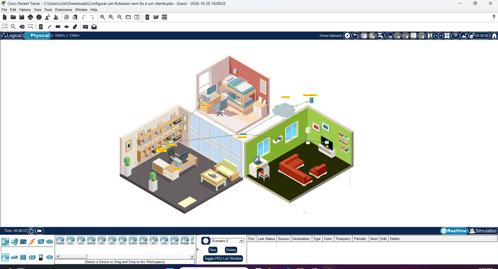

| Device | Connection | Port |
|---|---|---|
| Cable Splitter → Cable Modem | Coaxial | Coaxial1 → Port 0 |
| Cable Splitter → TV | Coaxial | Coaxial2 → Port 0 |
| Cable Modem → Home Wireless Router | Copper straight-through | Port 1 → Internet (WAN) |
| Office PC → Router | Copper straight-through | Fa0 → GigabitEthernet 1 (LAN) |
| Bedroom PC → Router | Copper straight-through | Fa0 → GigabitEthernet 2 (LAN) |
| Laptop → Router | Wireless (2.4 GHz) | SSID `MyHome` |

## What I configured

| Setting | Value | Why |
|---|---|---|
| Router LAN IP / mask | 192.168.0.1 / 255.255.255.0 | Default gateway for the home network |
| DHCP pool | Start 192.168.0.100, max **10** users | Only the devices the household needs |
| Admin password | Changed from `admin` | Default credentials are public knowledge |
| SSID (2.4 GHz) | `MyHome` | Wireless network for the household |
| Wireless security | **WPA2 Personal + AES** | Strongest option available on this router |
| Unused 5 GHz radios | Security disabled / radio not used | Reduces attack surface |
| Remote Management | Disabled (default kept) | Router GUI not reachable from the Internet |

## Steps and evidence

**1. Physical connections:** coaxial to the modem and TV, Ethernet to the router and PCs.

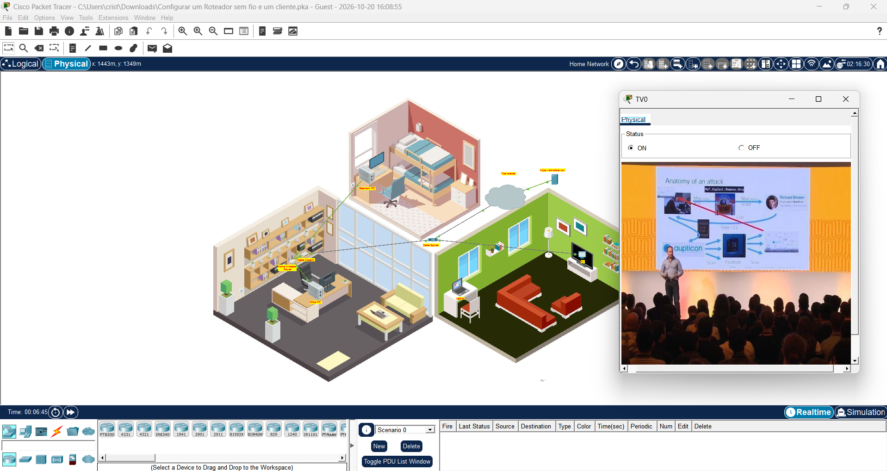

**2. DHCP on the Office PC:** the PC receives an IP, mask, gateway and DNS from the router.

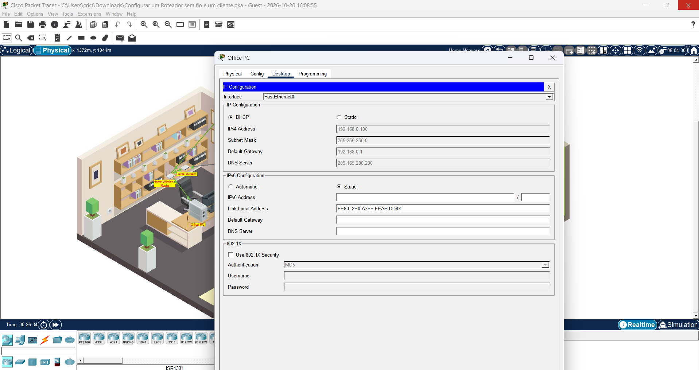

**3. Router configuration (web GUI at 192.168.0.1):** DHCP limit, admin password and Wi-Fi settings.

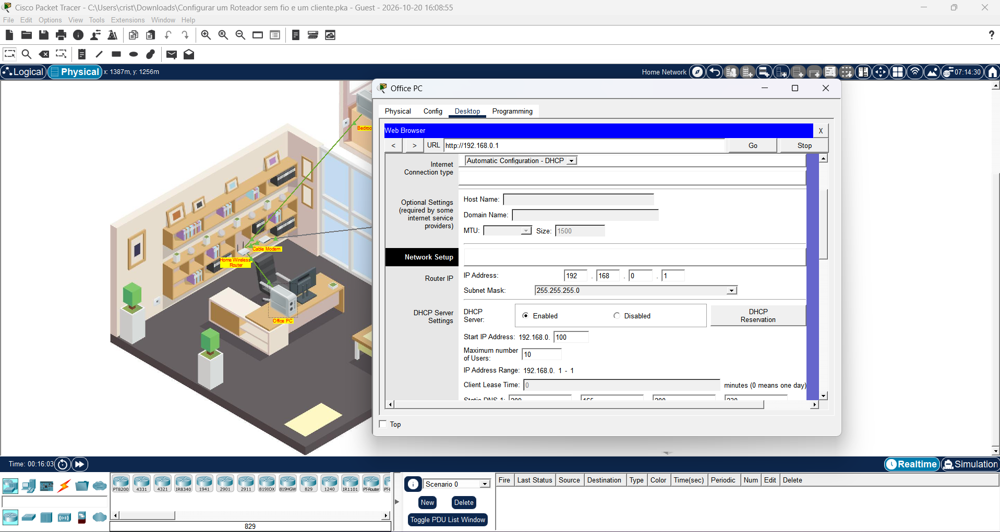
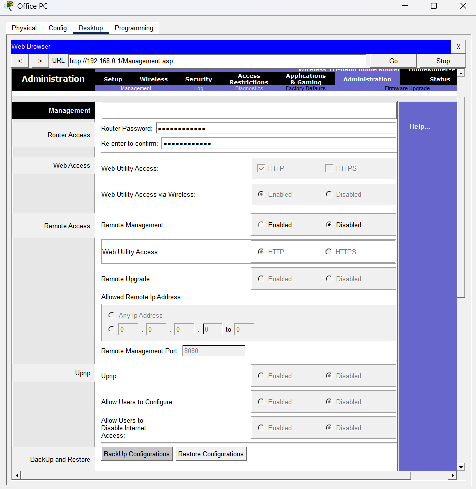
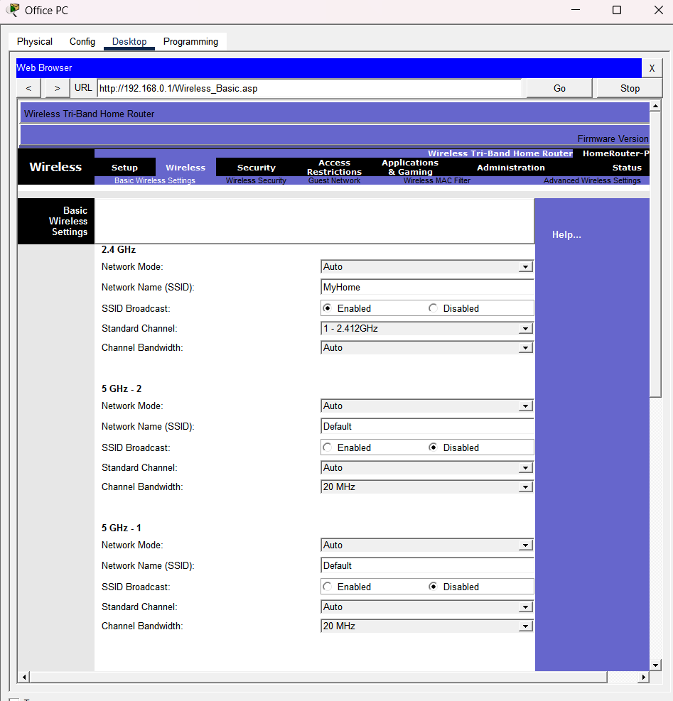

**4. Wireless client:** the laptop connects to `MyHome` using the WPA2 passphrase.

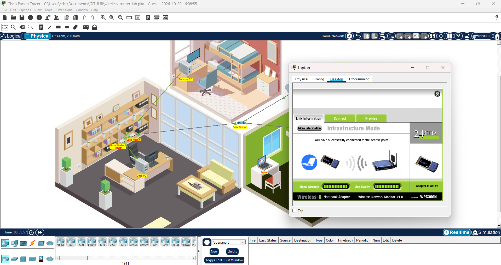

**5. Connectivity tests:** all three hosts load `skillsforall.srv` (an external server).

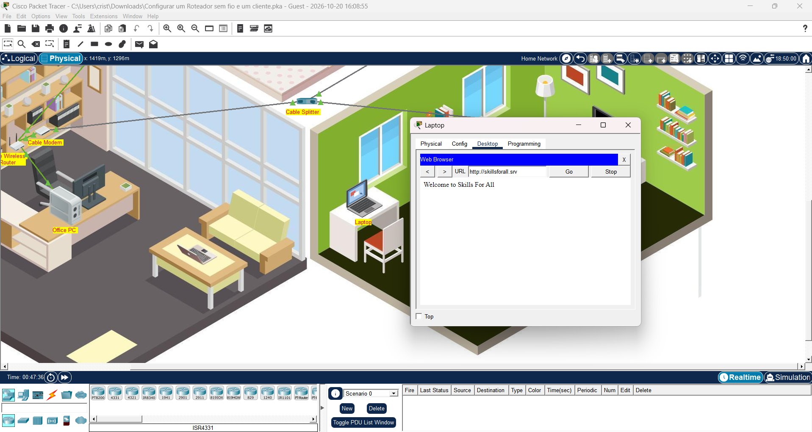
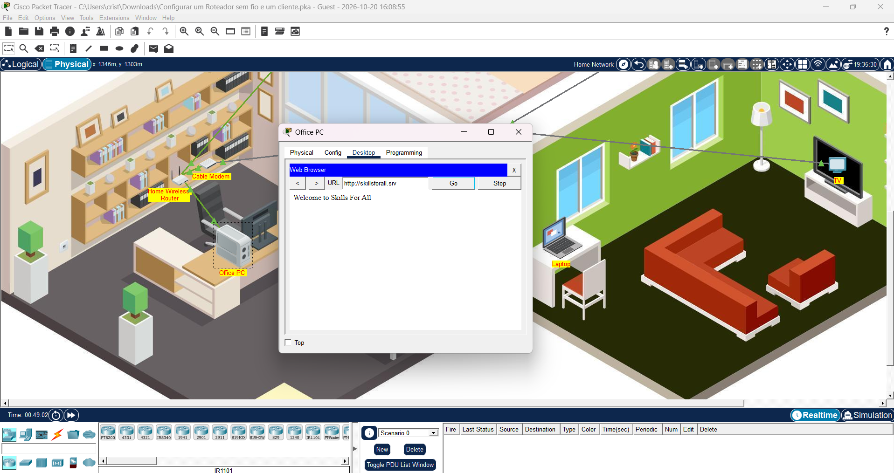
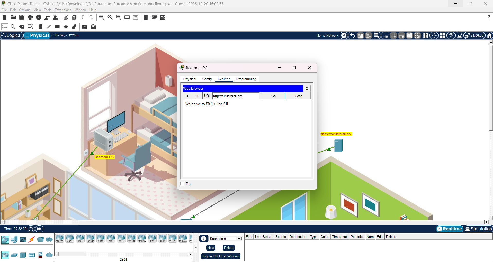

**6. Activity result**

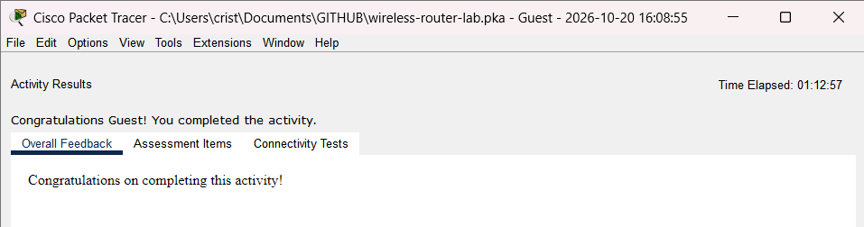

## Troubleshooting

The lab did not work on the first try. These were the problems and how I solved them.

### Issue 1: Office PC got a 169.254.x.x address (APIPA)

- **Symptom:** "DHCP request failed" and the IP 169.254.221.132. This is an APIPA address, which a host assigns to itself when no DHCP server answers.
- **Root cause:** the router's subnet mask had been accidentally changed to **255.255.255.252 (/30)** while editing the GUI. The dark theme made the field labels unreadable. A /30 network has only 2 usable addresses, so the DHCP server had nothing to lease.
- **Fix:** I gave the PC a temporary static IP (192.168.0.2) to reach the router GUI, then changed the mask back to 255.255.255.0 and the DHCP start address to .100. After that, the PC received 192.168.0.100 via DHCP.

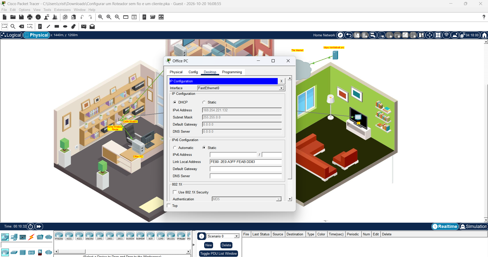
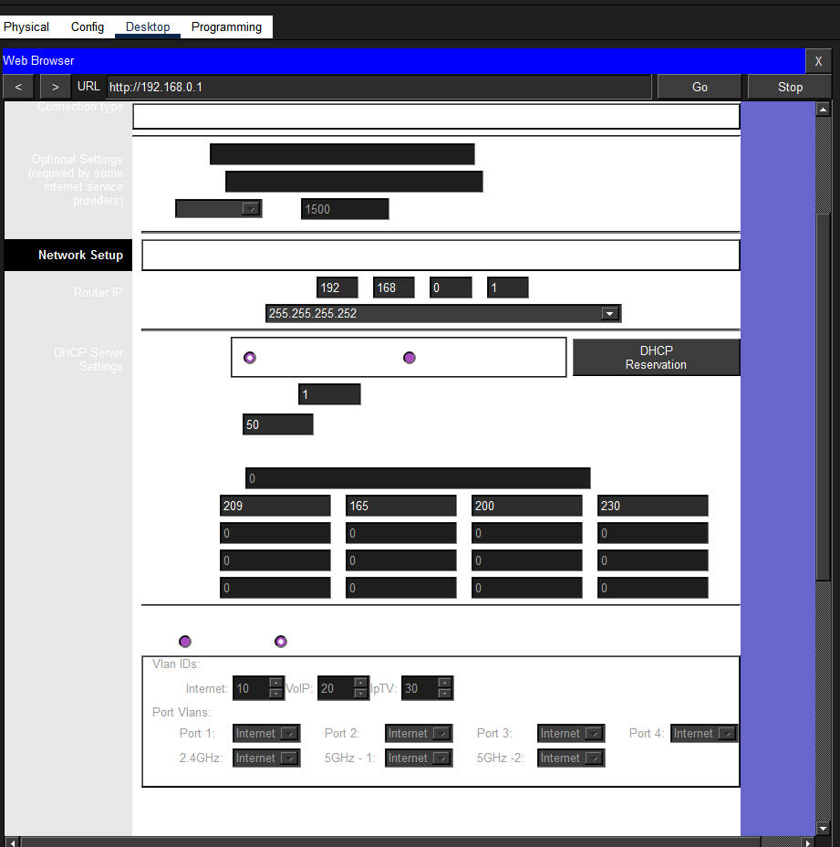

### Issue 2: "Host Name Unresolved" on the Bedroom PC

- **Symptom:** the browser could not open `skillsforall.srv`.
- **Root cause:** the host had not yet received its full DHCP configuration, including the DNS server, so it could not translate the name into an IP.
- **Fix:** I renewed DHCP (Static → DHCP), checked that the IP, gateway and DNS server were filled in, and tested again.

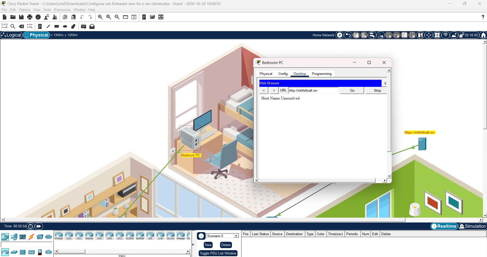

### Issue 3: The router refused to save the wireless security settings

- **Symptom:** "Passphrase should be minimum 8 and maximum 63 ascii chars long."
- **Root cause:** the unused **5 GHz-1** radio had been set to WPA Personal with an **empty passphrase**.
- **Fix:** I set the 5 GHz-1 security mode back to Disabled, so only the 2.4 GHz network uses WPA2.

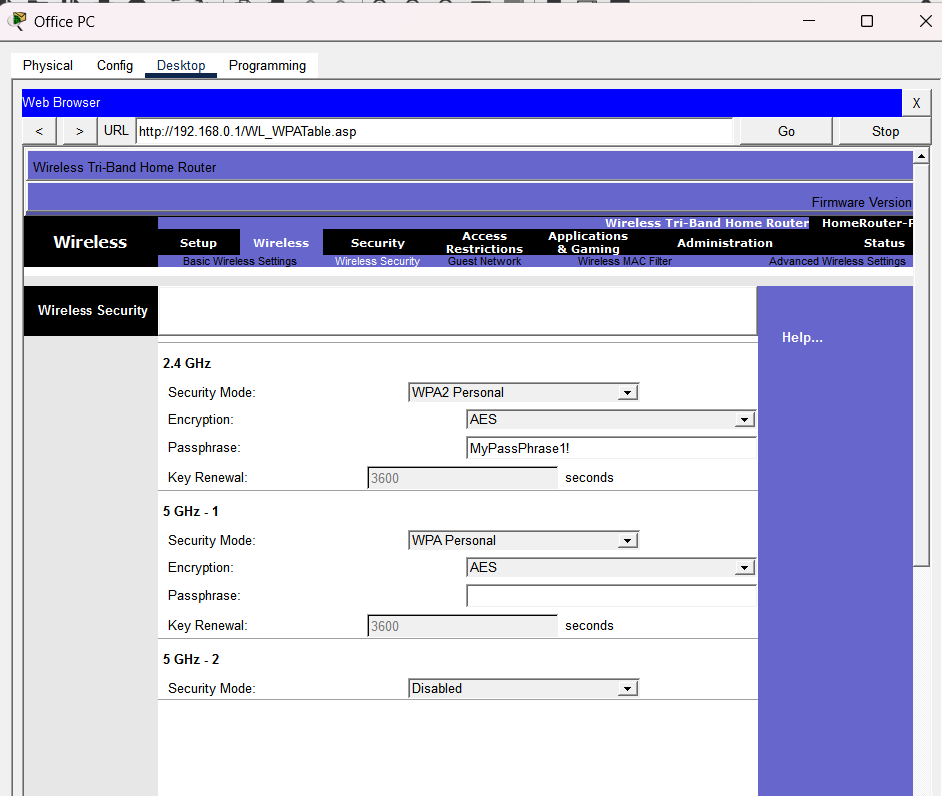

## Security takeaways

- **Default credentials** (`admin/admin`) are among the most common real-world misconfigurations. Change them first.
- **WPA2/WPA3 with a strong passphrase** is what actually protects a Wi-Fi network. Hiding the SSID or using MAC filtering is weak, because both can be bypassed with a sniffer or MAC spoofing.
- **Remote management stays disabled**, so the admin interface is never exposed to the Internet.
- **A 169.254.x.x address is a useful signal** during triage: the host could not reach a DHCP server.
- **Unused services and radios should stay disabled**, because a smaller attack surface is easier to defend.

## Files

- `wireless-router-lab.pka`: the completed Packet Tracer activity
- `screenshots/`: evidence for each step
