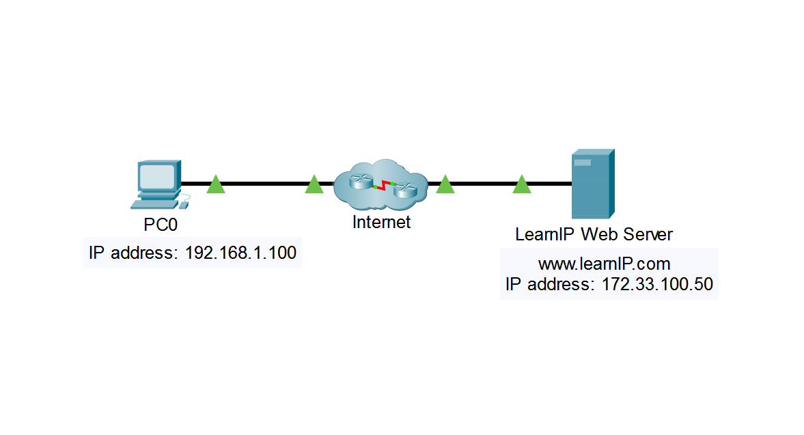
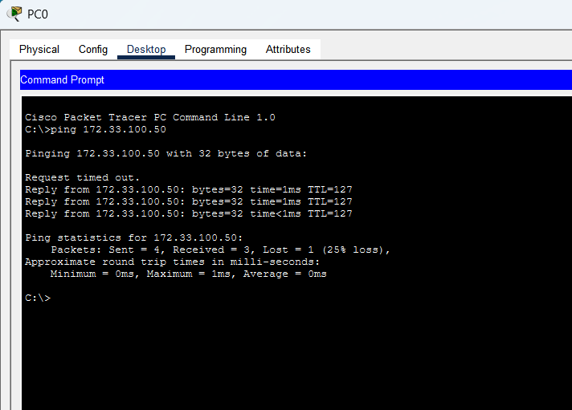
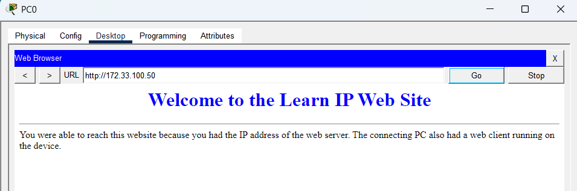
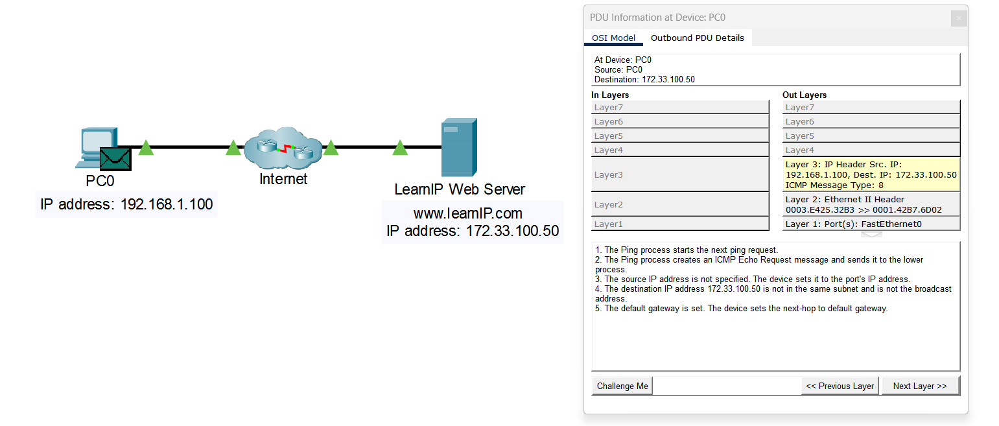
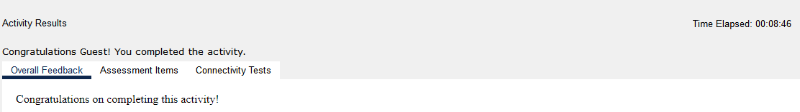

# Lab 02 – Connect to a Web Server

**Tool:** Cisco Packet Tracer · **Course:** Networking Basics (Cisco Networking Academy) · **Result:** ✅ Activity completed

## Scenario

A client (PC0) on a home network reaches a web server on a different network across the Internet, using only the server's IP address. The goal is to see how IP packets travel between networks.

## Topology

| Device | IP address | Network |
|---|---|---|
| PC0 (client) | 192.168.1.100 | 192.168.1.0 |
| LearnIP Web Server (`www.learnIP.com`) | 172.33.100.50 | 172.33.100.0 |
| Internet | Routers connecting both networks | — |

## Steps and evidence

**1. Connectivity test with ping (ICMP)**

- The first request **timed out**. This is expected: before sending the first packet, PC0 has to resolve the gateway's MAC address with **ARP**. The next replies arrived normally.
- **TTL=127:** the TTL is decremented by 1 at each router, so a value below the default 128 shows that the reply crossed a routed hop. The server is on a remote network.

**2. Access the website with the browser (HTTP)**

The page loaded using only the IP address `172.33.100.50`, with no domain name involved.

**3. Packet analysis in Simulation mode**

I opened the outbound ICMP packet on PC0 and looked at each layer:

| Layer | What the packet shows | Meaning |
|---|---|---|
| Layer 3 (IP) | Src **192.168.1.100** → Dst **172.33.100.50**, ICMP type 8 | Echo Request; the IP addresses stay the same end to end |
| Layer 2 (Ethernet) | Src MAC `0003.E425.32B3` → Dst MAC `0001.42B7.6D02` | The destination MAC is the **default gateway's**, not the server's |
| Layer 1 | FastEthernet0 | Physical port used |

The device log confirms the decision: *"The destination IP address 172.33.100.50 is not in the same subnet... The device sets the next-hop to default gateway."*

**4. Activity result**

## Key takeaways

- **IP addresses are end-to-end, MAC addresses are hop-by-hop.** The destination IP is the server's, but the frame is addressed to the next hop's MAC (the router).
- **The host compares the destination with its own subnet.** If the destination is remote, it sends the packet to the **default gateway**.
- **A first ping that times out** is often just ARP resolution, not a real failure.
- **SOC perspective:** reading source/destination IPs, protocol (ICMP/HTTP) and TTL is the base of traffic analysis. These are the same fields an IDS such as Suricata or Snort uses to match rules and raise alerts.

## Files

- `connect-web-server-lab.pka`: the completed Packet Tracer activity
- `screenshots/`: evidence for each step
