# Lab 03 – Configure DHCP on a Wireless Router

**Tool:** Cisco Packet Tracer · **Course:** Networking Basics (Cisco Networking Academy) · **Result:** ✅ Activity completed

## Scenario

A home user wants to connect 3 PCs to a wireless router, with every PC getting its IP address automatically. The task was to change the router's LAN address and the DHCP pool to a specific range, then check that all clients get addresses from the new pool and can reach each other.

## Topology

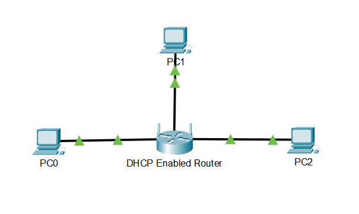

Three PCs are connected to the router's **LAN (Ethernet) ports** with copper straight-through cables, since they are different device types.

## Configuration: before and after

| Setting | Default | Configured |
|---|---|---|
| Router LAN IP | 192.168.0.1/24 | **192.168.5.1/24** |
| DHCP start address | 192.168.0.100 | **192.168.5.126** |
| Maximum number of users | 50 | **75** |
| DHCP pool | .100 – .149 | **.126 – .200** |

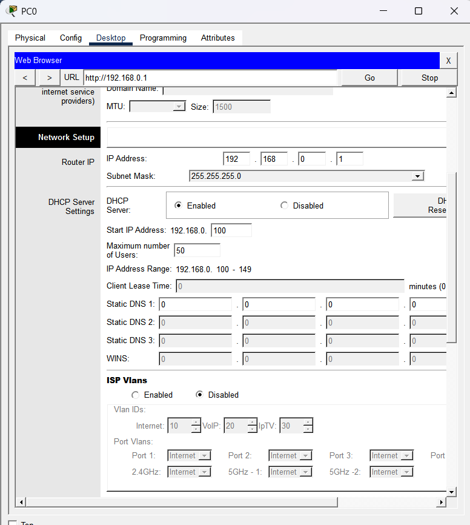
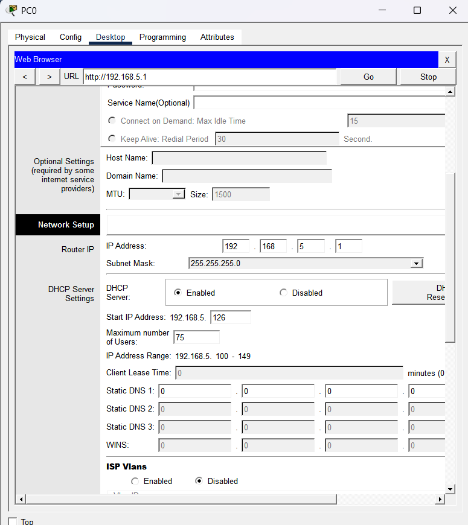

When the router IP changed, the DHCP start address moved to the new network by itself (192.168.5.100). I then set it to .126 as required.

## Results

| Host | IP received (DHCP) | Gateway |
|---|---|---|
| PC0 | 192.168.5.126 | 192.168.5.1 |
| PC1 | 192.168.5.127 | 192.168.5.1 |
| PC2 | 192.168.5.128 | 192.168.5.1 |

The addresses were leased in order, starting at the configured first address.

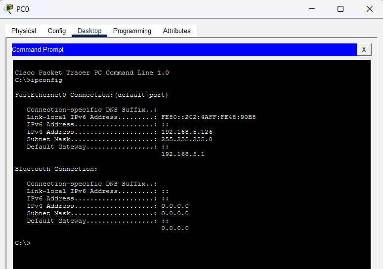
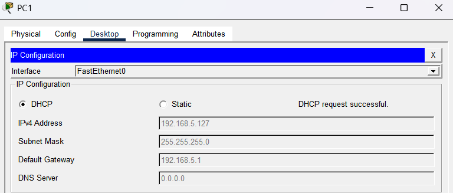
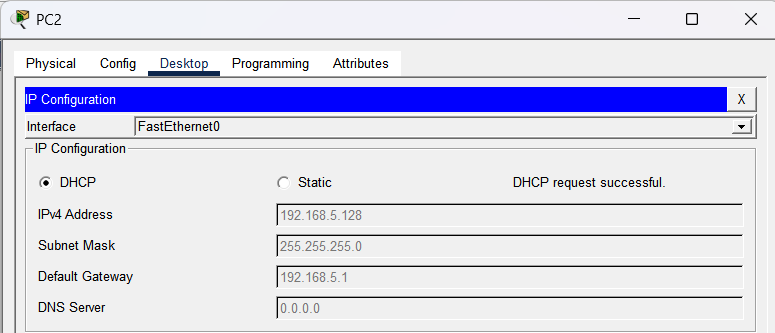

### Connectivity tests (from PC2)

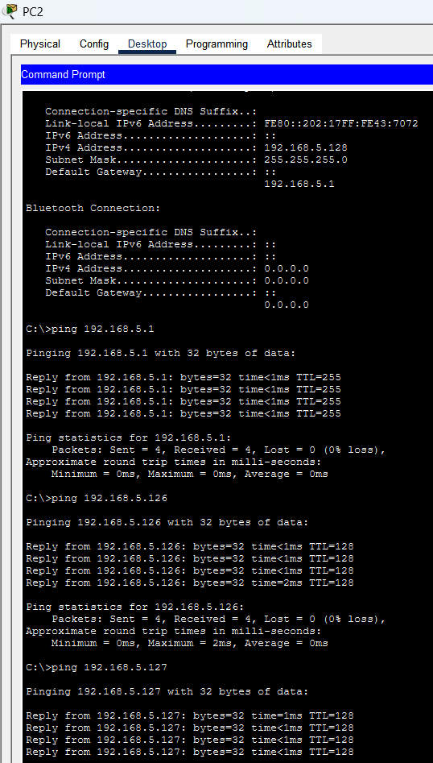

| Target | Result | TTL |
|---|---|---|
| Router 192.168.5.1 | 4/4 replies | 255 |
| PC0 192.168.5.126 | 4/4 replies | 128 |
| PC1 192.168.5.127 | 4/4 replies | 128 |

**TTL=128** shows that the PCs are on the same network, with no router in between. In Lab 02 the reply came with TTL=127, because the packet crossed one router.

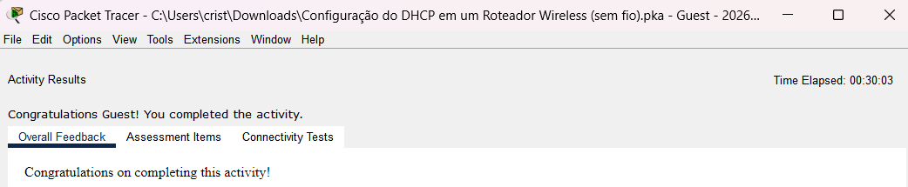

## Troubleshooting

### Issue 1: "Request Timeout" after saving the new router IP (expected)

- **Symptom:** the browser stopped responding right after **Save Settings**.
- **Root cause:** the router moved to 192.168.5.1, but PC0 still had an address in the old 192.168.0.0/24 network, so it lost contact with the router.
- **Fix:** I renewed the lease on PC0 (Static → DHCP) and opened the GUI at the new address.

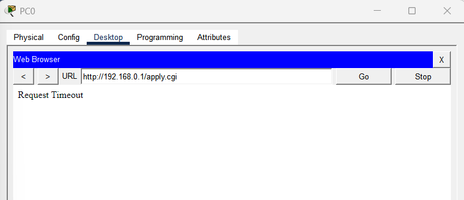

### Issue 2: PC0 got 169.254.144.184 (APIPA)

- **Symptom:** "DHCP failed. APIPA is being used."
- **Root cause:** PC0 asked for an address while the router was still applying the new DHCP settings, so no DHCPOFFER came back in time and the host assigned itself a link-local address.
- **Fix:** I advanced the simulation time and renewed DHCP again. PC0 then received 192.168.5.126.

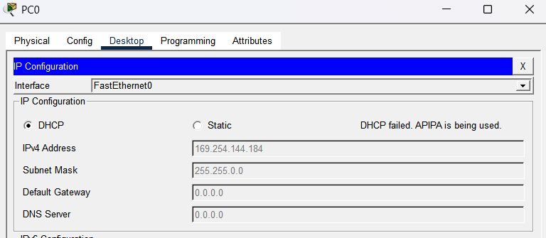
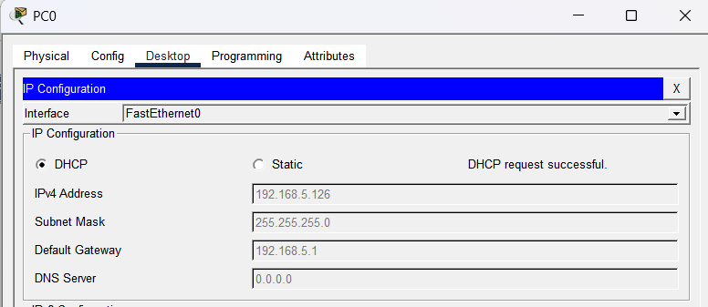

## Key takeaways

- **Changing the gateway's IP breaks existing clients until they renew their lease.** In a real network this is a planned change, done in a maintenance window.
- **The DHCP pool must be in the same network as the router's interface.** The router moves it automatically when its IP changes.
- **169.254.x.x (APIPA) means no DHCP server answered.** It is a quick triage signal: check the DHCP server, the link and the timing before anything else.
- **Security note:** DHCP has no authentication. A rogue DHCP server on the LAN could hand out a malicious gateway or DNS server, which is why switches use **DHCP snooping**. Unexpected DHCPOFFER traffic is something a SOC watches for.

## Files

- `dhcp-wireless-router-lab.pka`: the completed Packet Tracer activity
- `screenshots/`: evidence for each step
