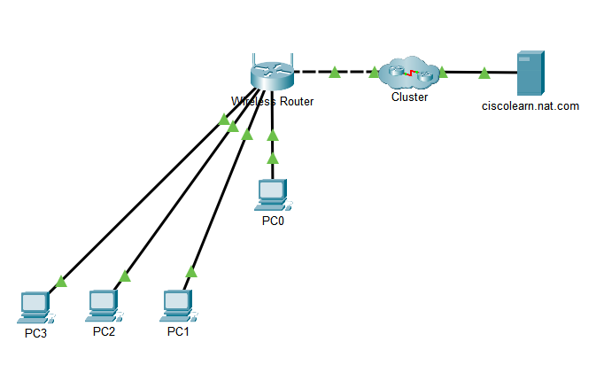
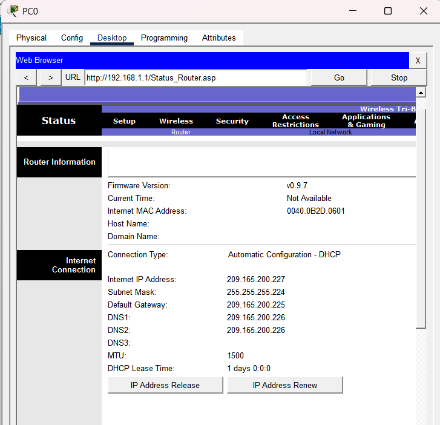
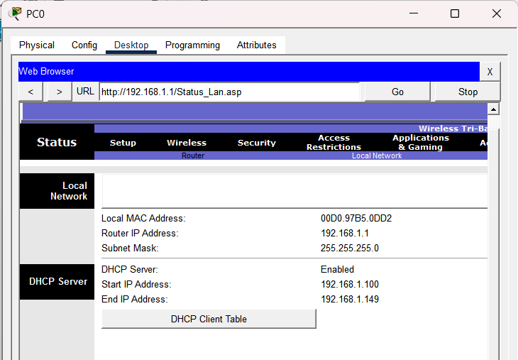
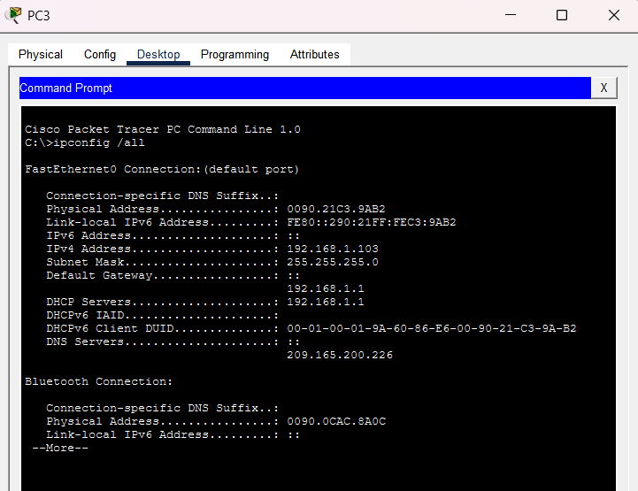
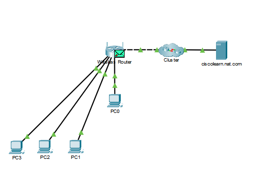
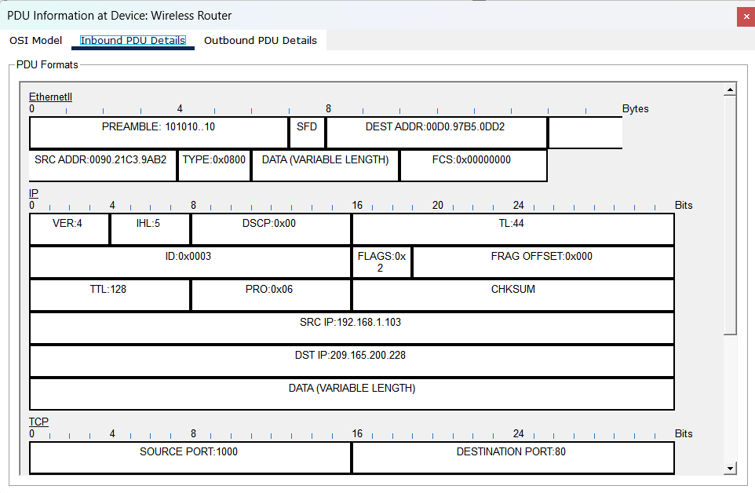
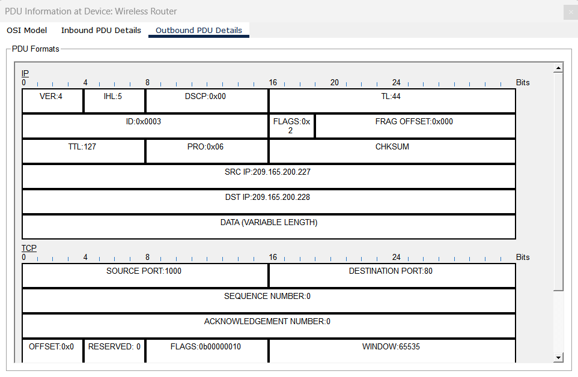
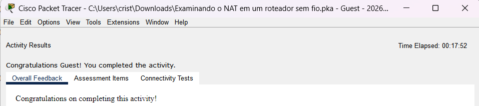

# Lab 04 – Examine NAT on a Wireless Router

**Tool:** Cisco Packet Tracer · **Course:** Networking Basics (Cisco Networking Academy) · **Result:** ✅ Activity completed

## Scenario

Four PCs on a home LAN use **private IPv4 addresses**, which cannot be routed on the Internet. The wireless router has to translate them with **NAT** before the traffic reaches a public web server (`ciscolearn.nat.com`). The goal was to see that translation happen inside the packet headers.

## Topology

| Side | Device / interface | Address |
|---|---|---|
| LAN (private) | Wireless router (gateway) | 192.168.1.1/24 |
| LAN (private) | DHCP pool for PC0–PC3 | 192.168.1.100 – 192.168.1.149 |
| WAN (public) | Wireless router Internet port (DHCP from the ISP) | 209.165.200.227/27 |
| Internet | Web server `ciscolearn.nat.com` | 209.165.200.228 |

## Steps and evidence

**1. The router's public (WAN) address.** The router received this address from the ISP's DHCP server.

**2. The router's private (LAN) network.** These are the addresses it hands out to the hosts.

**3. Clients via DHCP.** PC3 received 192.168.1.103, with gateway and DHCP server 192.168.1.1. Its **DNS server is 209.165.200.226**, a public address the router passed on from the ISP. That is how a host with a private IP can still resolve Internet names.

**4. HTTP traffic in Simulation mode.** I created a complex PDU from PC3: HTTP to the server, source port 1000, destination port 80, periodic every 120 s. Then I stopped the packet on the wireless router.

## NAT in action: the same packet entering and leaving the router

| Field | Inbound (from the LAN) | Outbound (to the Internet) |
|---|---|---|
| **Source IP** | **192.168.1.103** (private) | **209.165.200.227** (public) |
| Destination IP | 209.165.200.228 | 209.165.200.228 |
| TTL | 128 | 127 |
| Source / destination port | 1000 / 80 | 1000 / 80 |

- **Only the source IP changed.** The router replaced the private address with its public one, so the server sees all four PCs as **one single address**.
- **TTL went from 128 to 127**, because the packet crossed one routed hop.
- **The source port stayed 1000.** With **PAT** (NAT overload), the router changes the port only when two inside hosts use the same one at the same time. Here there was no conflict. The translation table maps `209.165.200.227:1000` back to `192.168.1.103:1000`, which is how the reply reaches the right PC.

## Key takeaways

- **NAT translates private inside addresses into a public outside address.** Its main advantage is that many hosts share one or a few public IPv4 addresses.
- **Private ranges (RFC 1918)** are 10.0.0.0/8, 172.16.0.0/12 and 192.168.0.0/16. They are not routed on the Internet.
- **Ports are part of the translation (PAT).** That is how one public IP serves several hosts at the same time.
- **SOC perspective:**
  - An external server, firewall or threat feed only sees the **public IP**. To find **which internal host** made a connection, an analyst has to correlate it with the router's or firewall's **NAT/PAT translation logs** (public IP + port + timestamp → private IP).
  - NAT hides the internal addressing, but it is **not a firewall**. Security still comes from access control and inspection.

## Files

- `nat-wireless-router-lab.pka`: the completed Packet Tracer activity
- `screenshots/`: evidence for each step
